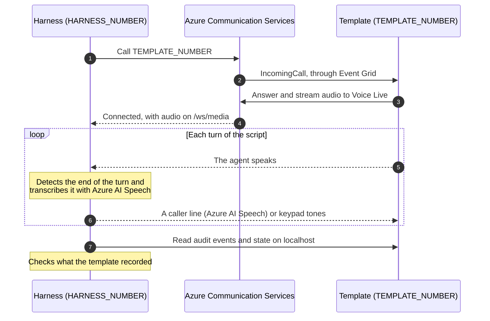

# Voice harness: live-call tests for the templates

The harness proves that each runnable template works on a real phone call. It owns a
second Azure Communication Services (ACS) phone number:

- For an inbound template, it calls the template's number.
- For an outbound template, it starts the template's call and answers it.

It then plays the caller. It speaks the caller's lines from the template's demo script,
listens to the agent, presses keys, and hangs up or waits for the template to hang up.
Finally, it checks the call flow against what the template itself recorded about the
call: its audit events, state, and outcome.

Unit and smoke tests cover each template's policy and transport separately. The harness
covers the whole path between them: the PSTN, Event Grid, Call Automation, media
streaming, Voice Live, the template's tools, and its audit trail.

- [How it works](#how-it-works)
- [Results](#results)
- [Set up](#set-up)
- [Run](#run)
- [Reports](#reports)
- [Write a suite](#write-a-suite)
- [Unit tests](#unit-tests)
- [Costs and limits](#costs-and-limits)
- [Troubleshooting](#troubleshooting)

## How it works



- **One template at a time.** `run` starts each template from its `code/` folder on
  `TEMPLATE_PORT` with a fresh database, waits for `/health`, runs its suite, and stops
  it.
- **Hermetic.** The template's own `code/.env` is never loaded: the harness points
  `DOTENV_CONFIG_PATH` at an empty file. A template gets the harness's settings, the
  suite's `env`, and its own defaults, so a developer's local configuration can't change
  what passes.
- **Server-side checks.** The harness reads the template's console hub (`/ws/hub`) to
  find the call, then its REST API (`/api/calls/:id` and `/api/calls/:id/events` by
  default). What the agent says is checked too, but mostly as soft checks.
- **No call is left open.** Every leg is hung up when a scenario ends, including when it
  fails, times out, or you press Ctrl+C.
- **A crash fails one scenario, not the run.** If the template exits during a scenario,
  or during the cooldown after it, the scenario fails `the template server kept running`
  with the error from the server log. The harness restarts the template before the next
  scenario.
- **It follows the right call.** Event Grid retries an `IncomingCall` that wasn't
  acknowledged, for example while a template was restarting, and a template can answer
  a retry as a second call. When more than one new call appears on the hub, the harness
  follows the one with the most traffic.
- **It knows when it joined late.** If media reaches the harness more than 15 seconds
  after it dials or answers, for example because a callback was delayed, the agent may
  have greeted a call the harness couldn't hear yet. The scenario gets a soft
  `the harness could hear the call from the start` check, and missing the first line it
  listens for, or a line expected `at some point`, warns instead of failing.
- **Phone numbers are redacted** in console output and reports.

## Results

| Result | Meaning |
| --- | --- |
| PASS | Every check passed. |
| WARN | Only soft checks failed. Soft checks cover the agent's wording and timing, which a realtime model varies from call to call. Read the timeline. |
| FAIL | A hard check failed: an audit event, state, or outcome the template must record. A check marked `fatal: false` fails the scenario but lets the call continue, so one broken step doesn't hide the rest of the flow. |
| ERROR | The scenario couldn't run: the call didn't connect, the template didn't start, or the scenario timed out. |
| SKIP | The scenario sets `skip`, with a reason. |

`run` exits with code 1 if any scenario failed or errored.

### Language check

After every scenario, the harness identifies the language of each thing the agent said.
If the agent said three or more words in a language the scenario doesn't allow, the
scenario fails. Its other checks still stand. A multilingual realtime model can open a
call in French or Spanish unless the template pins its language, and this check catches
that. Scenarios allow `en-US` unless the suite or scenario sets `languages`, for example
`["en-US", "es-US"]` for a bilingual template. The report labels every agent line that
wasn't in English with its locale.

## Set up

You need:

- Node.js 22 LTS, or 24.22 or later. See [Node 24](#node-24) for earlier Node 24
  releases.
- The Azure CLI, signed in with `az login`. The harness and the templates authenticate
  without keys, through `DefaultAzureCredential`.
- The [Dev Tunnels CLI](https://learn.microsoft.com/azure/developer/dev-tunnels/get-started).
- `npm ci` run in the `code/` folder of each template you test.
- A bash-compatible shell. On Windows, use WSL.

### Azure resources

| Resource | Used for | Role for your identity |
| --- | --- | --- |
| ACS resource with two phone numbers, both able to make and receive calls | Both ends of every call | **Communication and Email Service Owner** |
| AI Services resource with Voice Live | The templates' agents | **Cognitive Services User** and **Foundry User** |
| AI Services or Speech resource with a custom subdomain | The caller's voice, and transcribing the agent | **Cognitive Services User** |

One AI Services resource can serve both Voice Live and Speech.

### Dev tunnels

ACS must reach both web servers: the template on `TEMPLATE_PORT` (8091 by default) and
the harness on `HARNESS_PORT` (8089). Host one anonymous tunnel for each:

```bash
devtunnel create my-template --allow-anonymous
devtunnel port create my-template -p 8091
devtunnel host my-template

devtunnel create my-harness --allow-anonymous
devtunnel port create my-harness -p 8089
devtunnel host my-harness
```

Anyone who has a tunnel URL can reach the server behind it. Keep tunnel URLs out of
commits, issues, and logs.

### Configuration

```bash
cd scripts/voice-harness
npm ci
cp .env.example .env
```

Fill in `.env`. Every setting is described in [`.env.example`](.env.example). Set
`HARNESS_ENV_FILE` to load a different file.

| Setting | What it is |
| --- | --- |
| `ACS_ENDPOINT` | The ACS resource that owns both numbers |
| `TEMPLATE_NUMBER` | The number the templates answer, and outbound templates call from |
| `HARNESS_NUMBER` | The harness's own number |
| `TEMPLATE_PORT`, `TEMPLATE_PUBLIC_URL` | Where the template under test listens, and its tunnel |
| `HARNESS_PORT`, `HARNESS_PUBLIC_URL` | Where the harness listens, and its tunnel |
| `VOICE_LIVE_ENDPOINT` | The Voice Live resource, passed to every template |
| `SPEECH_ENDPOINT`, `HARNESS_VOICE` | The Speech resource and the caller's voice |

### Event Grid

Each number needs its own `IncomingCall` subscription on the ACS resource, filtered to
that number. Event Grid validates a webhook when you create its subscription, so the
server behind it must be running. Start the harness line with `node run.mjs serve`, and
any template with `npm start`.

```bash
ACS_ID=$(az communication show -n <acs-resource> -g <resource-group> --query id -o tsv)

az eventgrid event-subscription create --name voice-harness \
  --source-resource-id "$ACS_ID" \
  --endpoint "<HARNESS_PUBLIC_URL>/api/events" \
  --included-event-types Microsoft.Communication.IncomingCall \
  --advanced-filter data.to.phoneNumber.value StringIn "<HARNESS_NUMBER>"

az eventgrid event-subscription create --name voice-template \
  --source-resource-id "$ACS_ID" \
  --endpoint "<TEMPLATE_PUBLIC_URL>/api/events" \
  --included-event-types Microsoft.Communication.IncomingCall \
  --advanced-filter data.to.phoneNumber.value StringIn "<TEMPLATE_NUMBER>"
```

Every inbound template receives calls on `/api/events`, so the template subscription
serves every suite.

By default, Event Grid retries an undelivered `IncomingCall` for up to 24 hours. To drop
it after a minute instead, add `--event-ttl 1` to either command.

### Check the setup

```bash
node run.mjs doctor
```

`doctor` checks your configuration, Azure sign-in, a speech round trip, language
identification, and both tunnels. It also lists templates that still need `npm ci`, and
warns about [Node 24](#node-24) releases that crash on load.

## Run

```bash
node run.mjs list                                       # every suite and scenario
node run.mjs run                                        # everything, one template at a time
node run.mjs run --template intent-based-call-routing   # one template
node run.mjs run --template it-helpdesk-password-reset --scenario wrong-code-reread
```

`--template` and `--scenario` take comma-separated lists. `run` needs `TEMPLATE_PORT` to
be free. To test a template you started yourself, with its own configuration, add
`--attach`.

To play the caller yourself, which helps when you script a new scenario:

```bash
node run.mjs call            # call TEMPLATE_NUMBER (or --to <number>)
node run.mjs call --answer   # wait for a template to call the harness number
```

Type a line to say it, `/dtmf 12#` to press keys, and `/bye` to hang up. The agent's
replies print as they're transcribed.

## Reports

Each run writes `out/<run-id>/report.md` and `report.json`. For every scenario, the
report has:

- Its result and every check.
- A timeline of what the caller and the agent said.
- The audit events the template stored. `report.json` also has the template's final
  record of the call.

The template's server log is in each suite's folder.

Phone numbers are redacted, but a report holds whatever the template said and stored.
`out/` is git-ignored: keep reports local.

## Write a suite

A suite is a file in `scenarios/` named after the template's folder. Base its scenarios
on the template's `code/DEMO-SCRIPT.md` and `code/README.md`: the demo walkthrough
first, then each documented fallback, such as no input, an out-of-scope request, a
wrong answer, or a failed transfer. This example is simplified from
[`scenarios/intent-based-call-routing.mjs`](scenarios/intent-based-call-routing.mjs):

```js
export default {
  template: "intent-based-call-routing",
  title: "Intent-based call routing",
  direction: "inbound",
  probe: { idKey: "callId" },
  // Pinned to the shipped policy, so local configuration can't change what passes.
  env: { CONFIDENCE_THRESHOLD: "0.75", MAX_CLARIFICATIONS: "2", LOCALE: "en-US" },
  scenarios: [
    {
      name: "confident-billing",
      title: "Billing is proposed, confirmed, and dispatched",
      async run(t) {
        await t.dial();
        await t.hear(/automated assistant/i);
        await t.say("I was charged twice on my invoice.");
        await t.waitForEvent("route_proposed", { detail: /^billing @/ });
        await t.hear(/billing/i, { soft: true });
        await t.say("Yes please.");
        await t.waitForEvent("route_confirmed");
        await t.waitForState("transferring");
      },
    },
  ],
};
```

A file can export an array of suites, for example one per configuration. Give each its
own `id`.

### Suite fields

| Field | Purpose |
| --- | --- |
| `template` | The folder under `docs/templates` |
| `title`, `direction` | How the suite is listed: `inbound` or `outbound` |
| `id` | Tells apart several suites for one template |
| `env`, `prepare(runtime)` | The template's environment. `prepare` can write fixtures with `runtime.writeJson()` and returns more settings. An empty string unsets a setting. |
| `beforeEach(t)` | Runs before every scenario, for example to reset seeded data |
| `probe` | How to find the call: `idKey` (the id field on hub messages), `idTarget`, `recordPath(id)`, `eventsPath(id)`, and `hub: false` for a template without a hub |
| `languages` | Locales the agent may speak. The default is `["en-US"]`. |
| `order`, `cooldownMs` | Run order, and the pause between scenarios (4 seconds by default) |
| `scenarios` | `{ name, title, run(t), timeoutMs, languages, skip }` |

### The scenario API

| Area | Methods on `t` |
| --- | --- |
| Calls | `dial()`, `answer({ from, ringMs })`, `say(text)`, `dtmf(digits)`, `interrupt(text)`, `pause(ms)`, `hangup()`, `waitForHangup()`, `nextCall()` |
| Listening | `hear(pattern, { soft, timeoutMs })`, `replied(pattern, { soft, timeoutMs })`, `expectHeard(pattern)`, `converse({ until, replies, fallback })` |
| The template | `callId()`, `useId(id)`, `events()`, `snapshot()`, `api.get(path)`, `api.post(path, body)`, `hubMessages(target)` |
| Checks | `waitForEvent(kind, { detail, since })`, `expectNoEvent(kind)`, `hasEvent(kind)`, `eventMark()`, `waitForState(value, { field })`, `check(name, ok, detail, { soft, fatal })` |

Guidelines:

- Make hard checks on what the server records: events, state, and outcome. Check the
  agent's words with `soft: true`, unless the words are the point, such as a code read
  aloud.
- `hear(pattern)` only listens to turns that haven't been heard yet. After a
  `converse()` that stops once the server records something, the agent's last line has
  usually been heard already; check it with `replied(pattern)`, which starts from
  everything the agent said since the caller last spoke or pressed a key.
- Pin every shipped configuration path and policy value the scenario depends on, in
  `env` or `prepare`.
- For an outbound template, call `t.answer()` before you trigger the template's call,
  and await it afterwards.
- Use fictional data only.

## Unit tests

```bash
npm run check   # every module parses
npm test        # node:test; no network, no Azure
```

The tests cover voice activity detection, phone number redaction, reply matching, what
counts as the agent's reply to the caller, check levels, the language check, reports,
and the template probe. They also validate the shape of every suite, and fail if a
runnable template has no suite. CI runs them in the `voice-harness` job. CI never places
a call.

## Costs and limits

- **Real calls cost money.** Each number has a monthly fee. Every call is billed per
  minute on both legs, plus Voice Live and Speech usage. While you iterate, run one
  template or one scenario.
- **Teams transfers.** The harness can't play a Teams user. Unless a template's
  configuration points at real Teams users who answer, transfer scenarios exercise the
  template's transfer-failure path.
- **Teams Phone extensibility.** The harness calls an ACS phone number. It doesn't cover
  callers who reach an agent on a Teams service number.
- **Model variation.** A realtime model words things differently on every call. Soft
  checks absorb that, so read a WARN's timeline before you treat it as a regression.
- **Recognition.** Speech recognition over a phone line is good, not perfect.
  `heardDigits()` in `src/util.mjs` reads digits that the recognizer spelled out as
  words.

### Node 24

Node 24 releases before 24.22 abort when they load a native addon built against Node
24.19 or later headers. `better-sqlite3`'s prebuilt binaries are built that way, so a
template exits as soon as it opens its database. Use Node 22 LTS or 24.22 or later.
Alternatively, rebuild the addon in the template's `code/` folder against older
headers:

```bash
npm_config_nodedir=<path to node-v24.18.1 headers> npm_config_build_from_source=true \
  npm rebuild better-sqlite3
```

## Troubleshooting

| Symptom | What to check |
| --- | --- |
| `port 8091 is in use` | Stop the template you're running, or add `--attach`. |
| `TEMPLATE_PUBLIC_URL does not reach the template` | Host the template's dev tunnel. |
| `HARNESS_PUBLIC_URL does not reach the harness` | Host the harness's dev tunnel. |
| `the call was not answered` | The template subscription is missing, points at an old tunnel URL, or is filtered to another number. |
| `no call came in to the harness number` | The harness subscription is missing or stale. For an outbound template, check that it isn't in dry-run mode, and that its allow list includes `HARNESS_NUMBER`. |
| The call connects, but the harness hears nothing | Look for `MediaStreamingFailed` in the server log in the report folder, and run the template's `npm run smoke`. |
| `the agent spoke en-US` fails | The template didn't pin its language. Check its `LOCALE` setting. |
| A transfer fails with `Invalid CustomCallingContext in request, one or more provided voip headers with invalid key` | ACS rejects VoIP header keys that contain a period or an underscore, such as `CallDetails.CallTopic`. Keys made of letters, digits, and hyphens are accepted. Check the keys the template builds in `src/handoff.mjs`. |
